<!-- Header — animated typing SVG -->

 

  
  
  

<!--
  STATUS — the only line to edit when your situation changes. Swap the badge text, e.g.:
    Open%20to-Internships%20%C2%B7%20Immediate%20start
    Open%20to-Full--time%20roles
    Currently-Interning%20at%20<Company>
    Open%20to-Collaboration%20%26%20side%20projects
-->

---

I'm a <strong>Computer Science undergraduate at SLIIT, Sri Lanka</strong> who likes building things that run in production, not just on localhost.
I design <strong>secure backend APIs</strong>, ship <strong>full-stack web and mobile apps</strong>, and build the <strong>platform underneath them</strong> —
Kubernetes, GitOps, Terraform and CI/CD pipelines.

Outside coursework I've built a <strong>compiler for a custom testing DSL</strong>, implemented <strong>Raft consensus</strong> from scratch,
written a <strong>Kubernetes controller in Go</strong>, and shipped <strong>on-device AI</strong> in mobile apps.
Right now I'm going deep on <strong>Transformer architecture and deep learning</strong>.

📍 Kandy / Colombo, Sri Lanka &nbsp;·&nbsp;
🌐 <a href="https://ravidu.online">ravidu.online</a> &nbsp;·&nbsp;
✉️ <a href="mailto:raviduravisarad@gmail.com">raviduravisarad@gmail.com</a>

---

## 🛠️ Tech Stack

<table align="center">
  <tr>
    <td><strong>Languages</strong></td>
    <td>
      
      
      
      
      
      
      
      
      
    </td>
  </tr>
  <tr>
    <td><strong>Backend</strong></td>
    <td>
      
      
      
      
      
    </td>
  </tr>
  <tr>
    <td><strong>Frontend & Mobile</strong></td>
    <td>
      
      
      
      
    </td>
  </tr>
  <tr>
    <td><strong>Cloud & DevOps</strong></td>
    <td>
      
      
      
      
      
      
      
      
      
      
      
      
      
    </td>
  </tr>
  <tr>
    <td><strong>Observability & Security</strong></td>
    <td>
      
      
      
    </td>
  </tr>
  <tr>
    <td><strong>Databases</strong></td>
    <td>
      
      
      
      
    </td>
  </tr>
  <tr>
    <td><strong>ML & AI</strong></td>
    <td>
      
      
      
    </td>
  </tr>
  <tr>
    <td><strong>Testing & Tools</strong></td>
    <td>
      
      
      
      
      
    </td>
  </tr>
</table>

---

## 🚀 Featured Projects

<table>
  <tr>
    <td width="50%" valign="top">
      <h3><a href="https://github.com/raviduravisara/pr-preview">🔍 PR Preview — Ephemeral Environments</a></h3>
      
Every pull request gets its own live, isolated copy of the app — a dedicated Kubernetes namespace with its own PostgreSQL — and a bot comments the HTTPS URL on the PR in about two minutes. A custom <strong>Go controller</strong> reaps environments idle for 48h; <strong>Cloudflare Tunnel</strong> gives public HTTPS with no public IP.

      

        
        
        
        
      

      

        <a href="https://github.com/raviduravisara/pr-preview">📂 Code</a> &nbsp;·&nbsp;
        <a href="https://lnkd.in/p/gAq7xbFs">▶️ Demo video</a>
      

    </td>
    <td width="50%" valign="top">
      <h3><a href="https://github.com/raviduravisara/autopilot-devops">🚢 AutoPilot — AIOps Platform</a></h3>
      
Uptime-monitoring app where an <strong>Isolation Forest</strong> model reads live Prometheus metrics and diagnoses incidents on the dashboard. Delivered through <strong>GitOps with Argo CD</strong>, Sealed Secrets, dual CI (GitHub Actions + Jenkins), Trivy scanning and <strong>Terraform</strong>-provisioned Azure.

      

        
        
        
        
      

      

        <a href="https://github.com/raviduravisara/autopilot-devops">📂 Code</a>
      

    </td>
  </tr>
  <tr>
    <td width="50%" valign="top">
      <h3><a href="https://github.com/raviduravisara/hospital-management-system">🏥 HEALIX — Hospital Management</a></h3>
      
Hospital platform with 3 role-based dashboards, <strong>79 REST endpoints</strong>, JWT auth and RBAC. Tested at every level — <strong>102 xUnit tests</strong>, Playwright end-to-end, k6 and JMeter load tests — and deployed to Azure through GitHub Actions.

      

        
        
        
        
      

      

        <a href="https://github.com/raviduravisara/hospital-management-system">📂 Code</a>
      

    </td>
    <td width="50%" valign="top">
      <h3><a href="https://github.com/raviduravisara/shopease">🛒 ShopEase — E-Commerce Ecosystem</a></h3>
      
One Spring Boot + MongoDB backend with session auth serving both a <strong>React web app</strong> and a <strong>native Android app</strong> (Kotlin, Jetpack Compose, MVVM + Hilt). Full shopping flow — browse, wishlist, cart, checkout, orders, returns — plus admin dashboards.

      

        
        
        
        
      

      

        <a href="https://github.com/raviduravisara/shopease">📂 Code</a> &nbsp;·&nbsp;
        <a href="https://shopease-web.vercel.app/">🌐 Live demo</a> &nbsp;·&nbsp;
        <a href="https://youtu.be/-_dCkxzUPow">▶️ Video</a>
      

    </td>
  </tr>
  <tr>
    <td width="50%" valign="top">
      <h3><a href="https://github.com/raviduravisara/distributedsystem">🗄️ Distributed File Storage</a></h3>
      
Fault-tolerant file storage with <strong>Raft</strong> leader election, tunable consistency (ONE / QUORUM / ALL), heartbeat failure detection, automatic recovery, vector-clock metadata and a live cluster-health dashboard.

      

        
        
        
      

      

        <a href="https://github.com/raviduravisara/distributedsystem">📂 Code</a> &nbsp;·&nbsp;
        <a href="https://youtu.be/9tmj6pnWpAY">▶️ Demo video</a>
      

    </td>
    <td width="50%" valign="top">
      <h3><a href="https://github.com/raviduravisara/testlang">⚙️ TestLang++ — API Testing DSL</a></h3>
      
A small language for writing HTTP API tests, with a compiler in C (<strong>Flex + Bison</strong>) that turns <code>.test</code> specs into runnable <strong>JUnit 5</strong> suites. Full pipeline — lexer, parser, AST, semantic checks with line-numbered errors, and Java code generation.

      

        
        
        
      

      

        <a href="https://github.com/raviduravisara/testlang">📂 Code</a> &nbsp;·&nbsp;
        <a href="https://youtu.be/Y5PiRoyEicw">▶️ Demo video</a>
      

    </td>
  </tr>
</table>

  <strong>More:</strong>
  <a href="https://github.com/raviduravisara/medicalapp">🩺 Medical Scanner (Flutter + Gemini)</a> &nbsp;·&nbsp;
  <a href="https://github.com/raviduravisara/translator-app">🌐 Offline Translator</a> &nbsp;·&nbsp;
  <a href="https://github.com/raviduravisara/machine-learning-project">📈 House Price ML</a>
   
  Full write-ups, screenshots and demos at <a href="https://ravidu.online">ravidu.online</a>

---

## 📊 GitHub Stats

---

## 🤝 Connect with Me

---

  

